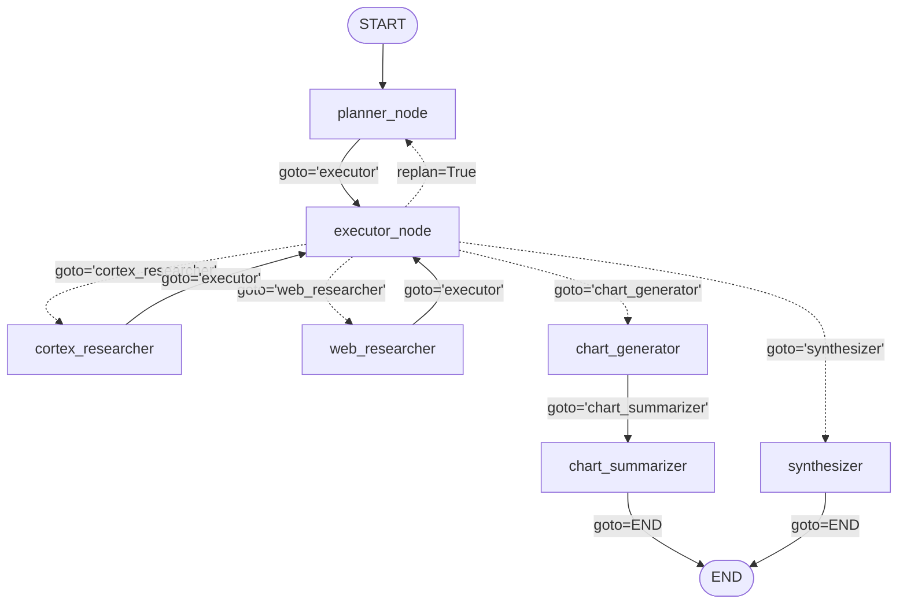

# Sales Data Agent: sistema multiagente autónomo con LangGraph y TruLens

[English](README.md) | **Español (Latinoamérica)**

Sistema autónomo multiagente de inteligencia de ventas, de nivel empresarial, construido con **LangGraph**. Integra **Snowflake Cortex** (Analyst Text-to-SQL y Cortex Search), **Tavily Web Search**, visualización dinámica con un REPL de Python y observabilidad completa con **TruLens** (RAG Triad + alineación GPA).

La aplicación se puede usar en **inglés** o en **español latinoamericano**: la interfaz y las respuestas finales siguen el idioma que elijas.

---

## Arquitectura

El sistema implementa un patrón adaptativo **Dynamic Plan & Execute**. En lugar de depender de un pipeline lineal estático o de un único bucle ReAct sin control, el flujo separa la planificación estratégica, el despacho dinámico de pasos y la ejecución de tareas especializadas.



### Pilares de la arquitectura

1. **Nodo planner (`planner_node`)**:
   - Usa un modelo de razonamiento avanzado (`o3` / `gpt-4o` con salida JSON estricta).
   - Genera planes secuenciales con **alineación GPA (Goal-Plan-Act)**: cada paso incluye el agente asignado, una acción concreta, una submeta verificable, precondiciones y poscondiciones.
   - Soporta **replanificación dinámica**: si un agente encuentra bloqueos o faltan datos, el executor dispara un replan; el planner recibe el plan anterior, el motivo del fallo (`last_reason`) y el historial reciente para armar un plan nuevo solo con los pasos pendientes.

2. **Nodo executor (`executor_node`)**:
   - Evalúa el avance paso a paso y la evidencia reunida en los mensajes.
   - Aplica límites de replanificación (`MAX_REPLANS = 3` por paso y `MAX_TOTAL_REPLANS = 5` por ejecución) para evitar bucles infinitos.
   - Despacha dinámicamente a los agentes especialistas con `Command(goto=..., update=...)` de LangGraph.

3. **Recuperación de datos heterogéneos**:
   - **Contexto interno (`cortex_researcher`)**:
     - *Cortex Analyst*: convierte lenguaje natural en SQL sobre las métricas de negocios del CRM, usando modelos semánticos (`@sales_intelligence.data.models/sales_metrics_model.yaml`) en el warehouse `SALES_INTELLIGENCE_WH`.
     - *Cortex Search*: búsqueda semántica sobre notas de reuniones y transcripciones de llamadas con clientes.
   - **Inteligencia pública externa (`web_researcher`)**:
     - Búsqueda web en tiempo real con Tavily: cambios regulatorios, valuaciones de mercado, movimientos de la competencia y noticias del sector.

4. **Visualización y síntesis**:
   - **`chart_generator`**: agente ReAct que escribe scripts de gráficos en Python, los ejecuta en el sandbox y devuelve `CHART_PATH` y `CHART_NOTES`.
   - **`chart_summarizer`**: redacta en 1 a 3 oraciones la lectura analítica del gráfico.
   - **`synthesizer`**: nodo final que consolida la evidencia de todas las fuentes en un informe ejecutivo con cifras y citas.

5. **Observabilidad y evaluación con TruLens**:
   - **RAG Triad**: evaluación de *Groundedness*, *Answer Relevance* y *Context Relevance*.
   - **Alineación GPA**: evaluaciones LLM-as-a-judge de *Plan Quality*, *Plan Adherence*, *Execution Efficiency* y *Logical Consistency*.
   - **Evaluaciones inline**: `@inline_evaluation(f_context_relevance)` en los nodos de recuperación para disparar un replan cuando baja la calidad del contexto.

---

## Estructura del proyecto

```text
Sales_Data_Agent/
├── .env.template          # Plantilla de variables de entorno
├── requirements.txt       # Dependencias con versiones mínimas
├── README.md              # Documentación (inglés)
├── README.es.md           # Documentación (español latinoamericano)
├── pytest.ini             # Configuración de pytest
├── Dockerfile             # Imagen multi-stage endurecida (sin root, health check, sin secretos)
├── docker-compose.yml     # App de Streamlit + dashboard de TruLens con un volumen compartido
├── .dockerignore          # Deja secretos, cachés y estado local fuera del build
├── .github/workflows/
│   └── ci.yml             # CI: calidad y secretos, pytest, smoke test e2e, verificación de la imagen Docker
├── app.py                 # Interfaz web de Streamlit con chat y gráficos
├── artifacts.py           # Gráficos para la UI (solo imágenes generadas en la ejecución actual)
├── i18n.py                # Traducciones de la UI e idioma de las respuestas (inglés / español latinoamericano)
├── state.py               # Esquema de estado, modelos Pydantic, carga de `.env`, mensajes y registro de agentes
├── prompts.py             # Prompts del sistema, del planner GPA y del executor
├── tools.py               # CortexAgentTool (SQL de solo lectura), Tavily y herramienta de Python en sandbox
├── sandbox.py             # Sandbox de tres capas para el código de gráficos
├── nodes.py               # Nodos orquestadores (planner, executor) y agentes ReAct especialistas
├── graph.py               # Construcción del StateGraph, build_graph(), run_agent() y topología
├── evals.py               # Suite de evaluación de TruLens (RAG Triad + GPA) y recorder
└── tests/                 # Suite de pytest (ver "Pruebas e integración continua")
```

### Módulos

- **[`app.py`](app.py)**: aplicación de Streamlit con chat (`st.chat_message`, `st.chat_input`), estado en vivo (`st.spinner`), selector de idioma, selector de agentes habilitados, scorecard opcional de TruLens por respuesta, plan de ejecución desplegable y gráficos guardados como bytes en cada mensaje.
- **[`i18n.py`](i18n.py)**: todos los textos visibles en inglés y español latinoamericano, preguntas de ejemplo por idioma, normalización de locales (`es-AR`, `es_419`, etc. se mapean a `es`) y la instrucción de prompt que hace que el synthesizer y el chart summarizer respondan en el idioma elegido.
- **[`state.py`](state.py)**: extiende `MessagesState` de LangGraph con `user_query`, `enabled_agents`, `plan`, `current_step`, `agent_query`, `last_reason`, `replan_flag`, `replan_attempts`, `final_answer`, `chart_path`, `chart_notes` y `language`. Incluye los modelos `PlanStep` y `ExecutorDecision`, `load_environment()`, las clases de mensajes y `DEFAULT_ENABLED_AGENTS`.
- **[`prompts.py`](prompts.py)**: centraliza el prompt engineering: `plan_prompt` (submetas GPA y avisos de replanificación), `executor_prompt` (router JSON) y los prompts de los agentes ReAct y del synthesizer.
- **[`tools.py`](tools.py)**: integraciones externas:
  - `CortexAgentTool`: ejecuta Snowflake Snowpark y Cortex Agent Service. Crea la sesión con las variables `SNOWFLAKE_*`, usa `SNOWFLAKE_WAREHOUSE` y solo ejecuta una sentencia `SELECT`/`WITH` de solo lectura. Tiene un modo mock automático cuando no hay credenciales.
  - `tavily_tool` / `get_tavily_tool`: búsqueda web con respaldo `MockTavilySearch`.
  - `python_repl_tool` / `PythonREPLTool`: shell de Python en sandbox para generar gráficos (ver [Arquitectura de seguridad](#arquitectura-de-seguridad-y-defensa-en-profundidad)).
  - `query_cortex_agent`, `search_web`, `run_python_code`: wrappers `(str) -> str` para los agentes ReAct; los de recuperación emiten spans `RETRIEVAL` de TruLens.
- **[`nodes.py`](nodes.py)**: todos los nodos del grafo: `planner_node`, `executor_node`, `cortex_agents_research_node`, `web_research_node`, `chart_node`, `chart_summary_node` y `synthesizer_node`.
- **[`graph.py`](graph.py)**: arma y compila el `StateGraph(State)`. Expone `build_graph()`, `run_agent()` y funciones de visualización de la topología (`get_graph_mermaid()`, `display_ascii_graph()`).
- **[`evals.py`](evals.py)**: configura las 7 métricas de evaluación (RAG Triad + GPA). Implementa `setup_trulens_recorder()` con persistencia en SQLite (ubicación tomada de `TRULENS_DATABASE_URL`) y el decorador `@inline_evaluation`.

---

## Arquitectura de seguridad y defensa en profundidad

El agente ejecuta código y SQL generados por un LLM, así que cada camino que toca código, datos o credenciales tiene más de una protección.

### Sandbox del código de gráficos (`sandbox.py`)

| Capa | Qué hace | Qué evita |
|------|----------|-----------|
| 1. Política AST | Analiza el código antes de ejecutarlo: lista blanca de imports (`matplotlib`, `seaborn`, `pandas`, `numpy`, ...), builtins prohibidos (`eval`, `exec`, `open`, `getattr`, ...) y atributos prohibidos (dunders, miembros privados, `os`, `subprocess`, `environ`, lectores de archivos como `pd.read_*`, `np.loadtxt`, `plt.imread`, y escritores como `np.save`, `to_excel` o `canvas.print_*` de matplotlib). `savefig()` solo acepta una ruta de imagen literal y relativa (`.png`, `.jpg`, `.jpeg`, `.svg`) sin `..`, y los formateadores (`to_csv`, `to_json`, `to_html`, `to_string`, ...) solo se permiten sin archivo de destino. | Imports de módulos del sistema operativo o de procesos, escapes por reflexión, lectura de `.env` o sobreescritura de archivos mediante librerías permitidas. |
| 2. Builtins restringidos | Ejecuta el código con un `__builtins__` mínimo y un `__import__` que valida la lista blanca, con el backend `Agg` sin interfaz gráfica. | Lo que la capa 1 no detecte en tiempo de ejecución. |
| 3. Aislamiento de proceso | Ejecuta el código validado en un intérprete hijo de corta vida (`python -I`) con un entorno en lista blanca (ninguna variable que contenga `KEY`, `SECRET`, `TOKEN` o `PASSWORD`), un timeout estricto (15 s por defecto) y un directorio de trabajo descartable. Solo se copian de vuelta los gráficos declarados con `savefig()`. | Robo de credenciales desde la memoria o el entorno, bucles infinitos (`while True: pass`), caídas del proceso de Streamlit y archivos creados por escritores que la capa 1 no conoce. |

Si no se puede crear un proceso hijo (por ejemplo, en un runtime embebido restringido), la ejecución vuelve a las capas 1 y 2 dentro del mismo proceso y registra una advertencia. El hijo todavía puede alcanzar rutas absolutas y la red si algún escritor de librería pasa la capa 1, por eso los despliegues expuestos a internet deben correr dentro de la imagen Docker provista.

### Datos y credenciales

- **SQL de solo lectura**: `CortexAgentTool` solo ejecuta una sentencia `SELECT`/`WITH`; DML, DDL, múltiples sentencias y funciones peligrosas se rechazan antes de llegar a Snowflake. El nombre del warehouse se valida como identificador.
- **Rol de mínimo privilegio**: `.env.template` usa `SNOWFLAKE_ROLE=SALES_ANALYST_RO`; un test falla si alguien vuelve a poner `ACCOUNTADMIN`.
- **Ruta de gráficos saneada**: el `CHART_PATH` que reporta el agente se resuelve y solo se acepta dentro del directorio de trabajo y con extensión de imagen, así la UI nunca lee archivos arbitrarios.
- **Los secretos no viajan en artefactos**: los archivos `.env` están ignorados por git y por Docker, la imagen corre con el usuario sin privilegios `appuser` y el CI busca claves filtradas en los archivos versionados.

---

## Preparación del entorno

### 1. Requisitos
- Python 3.10, 3.11 o 3.12 (recomendado)
- Git

### 2. Crear y activar un entorno virtual

**En Windows (PowerShell):**
```powershell
# Crear el entorno virtual
python -m venv venv

# Activarlo
.\venv\Scripts\Activate.ps1
```

**En macOS / Linux:**
```bash
# Crear el entorno virtual
python3 -m venv venv

# Activarlo
source venv/bin/activate
```

### 3. Instalar dependencias
```bash
pip install --upgrade pip
pip install -r requirements.txt
```

---

## Configuración (`.env`)

Copia `.env.template` como `.env`:

```bash
# Windows
copy .env.template .env

# macOS / Linux
cp .env.template .env
```

Edita `.env` con tus credenciales. Todos los módulos cargan `.env` automáticamente al importarse (las variables ya exportadas en tu shell tienen prioridad). Define `SALES_AGENT_SKIP_DOTENV=1` para desactivar la carga.

> **Seguridad:** conecta Snowflake con un rol de solo lectura y mínimo privilegio (por ejemplo `SALES_ANALYST_RO`). Nunca uses `ACCOUNTADMIN` para un agente de IA.

```ini
# ==============================================================================
# SALES DATA AGENT - ENVIRONMENT CONFIGURATION
# ==============================================================================

# --- OpenAI API (planificación, ejecución, síntesis y juez de TruLens) ---
OPENAI_API_KEY=sk-your-openai-api-key-here

# Selección de modelos
LLM_MODEL=gpt-4o
REASONING_LLM_MODEL=gpt-4o

# --- Tavily Search API (investigación web pública) ---
TAVILY_API_KEY=tvly-your-tavily-key-here

# --- Credenciales de Snowflake (Cortex Analyst y Search) ---
SNOWFLAKE_ACCOUNT=your-account-identifier
SNOWFLAKE_USER=your-username
SNOWFLAKE_PASSWORD=your-password
SNOWFLAKE_ROLE=SALES_ANALYST_RO
SNOWFLAKE_WAREHOUSE=SALES_INTELLIGENCE_WH
SNOWFLAKE_DATABASE=SALES_INTELLIGENCE
SNOWFLAKE_SCHEMA=DATA

# --- Telemetría y trazas de TruLens ---
TRULENS_OTEL_TRACING=1
TRULENS_DATABASE_URL=sqlite:///default.sqlite
TRULENS_DASHBOARD_PORT=8001
```

---

## Cómo ejecutarlo

### 1. Pipeline multiagente de punta a punta
Ejecuta `graph.py` desde la terminal (desde Python, usa `run_agent(consulta, language="es")` para recibir la respuesta en español latinoamericano):

```bash
python graph.py
```

Corre dos flujos representativos:
1. **Flujo con visualización**: *"What are our top 3 customer deals? Chart the deal value for each."*
   - Plan: `planner` → `executor` → `cortex_researcher` → `executor` → `chart_generator` → `chart_summarizer` → `END`.
   - Genera y guarda `top_deals_chart.png` en el directorio actual; la respuesta final combina la síntesis de los negocios con el resumen del gráfico.
2. **Flujo de síntesis**: *"What are our top 3 customer deals and what are the main themes in meeting notes?"*
   - Plan: `planner` → `executor` → `cortex_researcher` → `executor` → `web_researcher` → `executor` → `synthesizer` → `END`.
   - Genera un resumen ejecutivo con cifras y citas.

### 2. Suite de evaluación de TruLens
Ejecuta `evals.py` para correr una sesión instrumentada y ver el scorecard:

```bash
python evals.py
```

Imprime la respuesta final y una tabla con las 7 métricas (Answer Relevance, Context Relevance, Groundedness, Plan Quality, Plan Adherence, Execution Efficiency y Logical Consistency), cada una con su puntaje y su justificación.

### 3. Interfaz web de Streamlit
Levanta la aplicación para conversar con el sistema multiagente y ver los gráficos:

```bash
streamlit run app.py
```

Funciones de la interfaz:
- **Interfaz bilingüe**: el selector `Language / Idioma` de la barra lateral cambia todos los textos, las preguntas de ejemplo y el idioma de las respuestas finales entre inglés y español latinoamericano. Arranca en español cuando el navegador está en español. Los planes internos quedan en inglés.
- **Chat conversacional**: conserva el historial con `st.session_state` y `st.chat_message`.
- **Estado en vivo**: muestra un spinner mientras se orquestan los nodos.
- **Selección de agentes**: el multiselect `Agentes habilitados` se pasa a `run_agent(enabled_agents=...)`.
- **Scorecard de TruLens**: la casilla de evaluación muestra las 7 métricas (RAG Triad + GPA) por respuesta, registradas por un recorder de TruLens propio de cada sesión del navegador.
- **Gráficos dinámicos**: muestra el gráfico del estado del grafo (`chart_path`) solo si se generó en la ejecución actual y guarda sus bytes en el historial, para que los gráficos anteriores nunca se pisen.
- **Inspección del plan**: visor JSON desplegable con el plan de ejecución multiagente.
- **Diagnóstico de conexiones**: indicadores de OpenAI, Tavily y Snowflake Cortex.

### 4. Dashboard de observabilidad de TruLens
Cuando ya haya trazas y evaluaciones en la base SQLite, levanta el dashboard:

```bash
python -c "from trulens.dashboard import run_dashboard; run_dashboard(port=8001)"
```

Abre `http://localhost:8001` para explorar trazas, latencias, consumo de tokens y distribución de las evaluaciones.

---

## Ejecución con Docker y Docker Compose

Levanta la app de Streamlit y el dashboard de TruLens juntos:

```bash
docker compose up --build
```

| Servicio | URL | Propósito |
|----------|-----|-----------|
| `sales-data-agent` | http://localhost:8501 | Interfaz de chat de Streamlit |
| `trulens-dashboard` | http://localhost:8001 | Trazas y evaluaciones de TruLens (arranca cuando la app está sana; solo escucha en `127.0.0.1`) |

Cómo está armado:

- **Credenciales**: un `.env` opcional en la raíz se inyecta al ejecutar (`env_file`, `required: false`). Sin él, todo corre en modo mock. Los secretos nunca se copian a la imagen.
- **Persistencia**: los dos servicios montan el volumen `trulens-data` en `/app/data` y usan `TRULENS_DATABASE_URL=sqlite:////app/data/default.sqlite`, así los registros sobreviven a los reinicios y el dashboard lee lo que escribe la app. El scorecard lee solo los registros de la ejecución actual. Los registros reales de TruLens requieren `OPENAI_API_KEY`; en modo mock la base queda vacía.
- **Exposición del dashboard**: no tiene autenticación y muestra todas las consultas y respuestas registradas, por eso solo escucha en el loopback del host y no recibe credenciales. Ponlo detrás de un proxy con autenticación antes de exponerlo.
- **Endurecimiento**: la imagen corre como `appuser` (UID 10001), verifica `/_stcore/health` y los contenedores descartan todas las capabilities de Linux con `no-new-privileges`.

Detén todo con `docker compose down` (agrega `-v` solo si quieres borrar el volumen de datos de TruLens).

---

## Pruebas e integración continua

Corre la suite completa en local:

```bash
python -m pytest -v
```

La suite fuerza el modo mock (sin red y sin `.env`), así que es determinista y no tiene costo.

| Módulo de pruebas | Qué valida |
|-------------------|------------|
| `test_state_and_prompts.py` | Esquemas Pydantic, carga de `.env`, prompts y el contrato de mínimo privilegio de `.env.template`. |
| `test_tools_and_security.py` | Integraciones mock, la protección de SQL de solo lectura y las tres capas del sandbox (política, timeout, hijo sin secretos y directorio descartable). |
| `test_nodes_and_graph.py` | Ruteo del planner y del executor, límites de replanificación por paso y por ejecución, flujos de gráficos (incluido un `chart_summarizer` deshabilitado), ejecuciones completas del grafo y el idioma de la respuesta. |
| `test_artifacts.py` | Frescura de los gráficos: las imágenes de ejecuciones anteriores nunca se adjuntan a una respuesta nueva. |
| `test_production_contracts.py` | Caminos de producción sin red: parseo del stream SSE de Cortex y su fallback, construcción de `ChatOpenAI`, lectura de evaluaciones de TruLens, atributos de spans `RETRIEVAL` y resolución de la URL de la base. |
| `test_streamlit_app.py` | La UI real con `AppTest` de Streamlit: carga inicial, respuestas con plan y scorecard de 7 métricas, gráficos persistidos, borrado del historial, sin advertencias de deprecación, e interfaz y respuestas en español. |
| `test_i18n.py` | Paridad de traducciones entre inglés y español, normalización de locales e instrucción de idioma de la respuesta. |
| `test_container_config.py` | Invariantes de Docker: usuario sin root, health check, backend `Agg`, sin `.env` en la imagen, volumen compartido de TruLens y el job de imagen del CI. |

[GitHub Actions](.github/workflows/ci.yml) corre en cada push a `main`, `fix/**` y `feat/**`, y en los pull requests hacia `main`, con permisos de solo lectura y cancelación de ejecuciones superadas:

1. **quality-and-security**: instala dependencias en Python 3.12, compila todos los módulos y busca secretos filtrados o archivos `.env` versionados.
2. **test-suite**: `pytest -v --tb=short`.
3. **e2e-smoke-test**: `python graph.py` y `python evals.py` en modo mock.
4. **docker-image**: valida `docker-compose.yml`, construye la imagen, espera a que el contenedor quede sano y verifica que corra como `appuser` (UID 10001) sin un `.env` dentro. Cualquiera que clone el repositorio obtiene una imagen verificada en cada push, sin necesitar Docker en su máquina.

---

## Modo sin conexión y pruebas con mocks

El proyecto está pensado para probarse sin fricción:
- **Detección automática**: si faltan `OPENAI_API_KEY`, `TAVILY_API_KEY` o las credenciales `SNOWFLAKE_*`, o si los paquetes externos no están instalados, el código usa motores mock de alta fidelidad (`MockChatModel`, `MockTavilySearch`, el mock de `CortexAgentTool` y `MockTruGraph`). Las respuestas mock también salen en español cuando eliges ese idioma.
- **CI/CD reproducible**: las pruebas corren en pipelines aislados sin hacer pedidos a la red ni gastar en APIs de LLM.
- **Listo para producción**: en cuanto configuras credenciales válidas, las mismas interfaces pasan a usar LLMs reales y Snowflake Cortex sin cambiar código.

---

## Licencia

Licencia MIT. Diseñado para flujos multiagente empresariales con LangGraph y TruLens.
