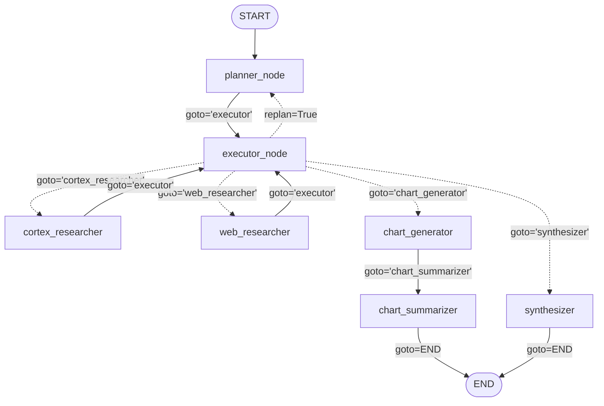

# Sales Data Agent: Autonomous Multi-Agent System with LangGraph & TruLens

An enterprise-grade, autonomous Multi-Agent Sales Intelligence system built with **LangGraph**, integrating **Snowflake Cortex** (Analyst Text-to-SQL & Cortex Search), **Tavily Web Search**, dynamic Python REPL visualization, and full-stack observability with **TruLens** (RAG Triad + GPA Alignment).

---

## Architecture Overview

The system implements an adaptive **Dynamic Plan & Execute** pattern. Rather than relying on a static linear pipeline or an unconstrained single ReAct loop, the workflow separates strategic planning, dynamic step dispatching, and specialized task execution.



### Key Architectural Pillars

1. **Planner Node (`planner_node`)**:
   - Uses an advanced reasoning model (`o3` / `gpt-4o` with strict JSON output format).
   - Generates sequential plans with **GPA Alignment (Goal-Plan-Act)**: each step includes a designated agent, concrete action, explicit verifiable sub-goal, preconditions, and postconditions.
   - Supports **Dynamic Replanning**: if an upstream agent encounters blockers or missing data, the executor triggers a replan; the planner receives the previous plan, failure reasons (`last_reason`), and recent message history to synthesize an updated course of action.

2. **Executor Node (`executor_node`)**:
   - Evaluates step-by-step progress and evidence collected across messages.
   - Enforces execution safeguards with bounded replan accounting (`MAX_REPLANS = 3` per step) to eliminate infinite loops.
   - Dispatches dynamically to specialized worker agents using LangGraph's `Command(goto=..., update=...)`.

3. **Heterogeneous Data Retrieval**:
   - **Internal Enterprise Context (`cortex_researcher`)**:
     - *Cortex Analyst*: Converts natural language to SQL queries against structured CRM deal metrics using semantic data models (`@sales_intelligence.data.models/sales_metrics_model.yaml`) on the `SALES_INTELLIGENCE_WH` warehouse.
     - *Cortex Search*: Performs vector/semantic similarity search across unstructured customer meeting notes and call transcripts.
   - **External Public Intelligence (`web_researcher`)**:
     - Real-time web retrieval via Tavily Search for regulatory shifts, public market valuations, competitor actions, and industry news.

4. **Visualization & Synthesis**:
   - **`chart_generator`**: Autonomous ReAct agent that writes Python plotting scripts, executes them in a local REPL environment, and outputs `CHART_PATH` and `CHART_NOTES`.
   - **`chart_summarizer`**: Concise captioning agent that synthesizes the visual findings into 1-3 crisp analytical sentences.
   - **`synthesizer`**: Terminal node that consolidates multi-source evidence into an executive prose report complete with numerical metrics and citations.

5. **Full-Stack Observability & Evaluation with TruLens**:
   - **RAG Triad**: Real-time evaluation of *Groundedness*, *Answer Relevance*, and *Context Relevance*.
   - **GPA Alignment**: Comprehensive LLM-as-a-judge evaluations auditing *Plan Quality*, *Plan Adherence*, *Execution Efficiency*, and *Logical Consistency*.
   - **Inline Evaluations**: Runtime feedback loops (`@inline_evaluation(f_context_relevance)`) on retrieval nodes to trigger corrective replanning when retrieved context quality drops.

---

## Modular Project Structure

```text
Sales_Data_Agent/
├── .env.template          # Environment variables template with configuration guidance
├── requirements.txt       # Production dependencies with pinned versions
├── README.md              # Project documentation, architecture, and setup instructions
├── app.py                 # Interactive Streamlit web interface with chat and chart rendering
├── state.py               # Strongly-typed State schema (MessagesState) & Pydantic models
├── prompts.py             # System prompts, GPA plan prompts, and executor decision prompts
├── tools.py               # CortexAgentTool, TavilySearch, and PythonREPLTool (with mock fallback)
├── nodes.py               # Orchestrator nodes (planner, executor) & specialized ReAct workers
├── graph.py               # StateGraph construction, build_graph(), run_agent() & topology
├── evals.py               # TruLens RAG Triad + GPA Alignment evaluation suite & recorder
└── top_deals_chart.png    # Sample chart artifact produced by the multi-agent pipeline
```

### Module Breakdown

- **[`app.py`](app.py)**: Streamlit web application providing a conversational UI (`st.chat_message`, `st.chat_input`), real-time execution status (`st.spinner`), expandable multi-agent execution plans, and dynamic chart artifact rendering (`top_deals_chart.png`).
- **[`state.py`](state.py)**: Extends LangGraph's `MessagesState` with typed attributes: `user_query`, `enabled_agents`, `plan`, `current_step`, `agent_query`, `last_reason`, `replan_flag`, `replan_attempts`, and `final_answer`. Includes `PlanStep` and `ExecutorDecision` Pydantic models for structured output validation.
- **[`prompts.py`](prompts.py)**: Centralizes all prompt engineering. Features `plan_prompt` (incorporating L6 GPA sub-goals and replanning notices), `executor_prompt` (JSON router schema), and system prompts for all ReAct agents and the synthesizer.
- **[`tools.py`](tools.py)**: Encapsulates external integrations:
  - `CortexAgentTool`: Snowflake Snowpark and Cortex Lite Agent Service runner. Includes an automatic high-fidelity mock fallback when credentials are not configured.
  - `tavily_tool` / `get_tavily_tool`: Web search with `MockTavilySearch` fallback.
  - `python_repl_tool` / `PythonREPLTool`: In-memory Python shell for plotting charts.
- **[`nodes.py`](nodes.py)**: Implements all graph nodes. Encapsulates `planner_node`, `executor_node`, `cortex_agents_research_node`, `web_research_node`, `chart_node`, `chart_summary_node`, and `synthesizer_node`.
- **[`graph.py`](graph.py)**: Assembles and compiles the `StateGraph(State)`. Exposes `build_graph()`, `run_agent()`, and graph topology visualization functions (`get_graph_mermaid()`, `display_ascii_graph()`).
- **[`evals.py`](evals.py)**: Configures the 7 evaluation metrics across the RAG Triad and GPA dimensions. Implements `setup_trulens_recorder()` with SQLite persistence and the `@inline_evaluation` decorator.

---

## Environment Setup

### 1. Prerequisites
- Python 3.10, 3.11, or 3.12 (recommended)
- Git

### 2. Create and Activate a Virtual Environment

**On Windows (PowerShell):**
```powershell
# Create virtual environment
python -m venv venv

# Activate virtual environment
.\venv\Scripts\Activate.ps1
```

**On macOS / Linux:**
```bash
# Create virtual environment
python3 -m venv venv

# Activate virtual environment
source venv/bin/activate
```

### 3. Install Dependencies
```bash
pip install --upgrade pip
pip install -r requirements.txt
```

---

## Configuration (`.env`)

Copy the provided `.env.template` to `.env`:

```bash
# Windows
copy .env.template .env

# macOS / Linux
cp .env.template .env
```

Edit `.env` to supply your credentials:

```ini
# ==============================================================================
# SALES DATA AGENT - ENVIRONMENT CONFIGURATION
# ==============================================================================

# --- OpenAI API (Planning, Execution, Synthesis, and TruLens Judge) ---
OPENAI_API_KEY=sk-your-openai-api-key-here

# Model Selection
LLM_MODEL=gpt-4o
REASONING_LLM_MODEL=gpt-4o

# --- Tavily Search API (Public Web Research) ---
TAVILY_API_KEY=tvly-your-tavily-key-here

# --- Snowflake Credentials (Cortex Analyst & Search) ---
SNOWFLAKE_ACCOUNT=your-account-identifier
SNOWFLAKE_USER=your-username
SNOWFLAKE_PASSWORD=your-password
SNOWFLAKE_ROLE=ACCOUNTADMIN
SNOWFLAKE_WAREHOUSE=SALES_INTELLIGENCE_WH
SNOWFLAKE_DATABASE=SALES_INTELLIGENCE
SNOWFLAKE_SCHEMA=DATA

# --- TruLens Telemetry & Tracing ---
TRULENS_OTEL_TRACING=1
TRULENS_DATABASE_URL=sqlite:///default.sqlite
TRULENS_DASHBOARD_PORT=8001
```

---

## How to Run

### 1. Run the Multi-Agent Pipeline End-to-End
Execute `graph.py` directly from your terminal:

```bash
python graph.py
```

This runs two representative end-to-end flows:
1. **Visualization Flow**: *"What are our top 3 customer deals? Chart the deal value for each."*
   - Plan: `planner` $\rightarrow$ `executor` $\rightarrow$ `cortex_researcher` $\rightarrow$ `executor` $\rightarrow$ `chart_generator` $\rightarrow$ `chart_summarizer` $\rightarrow$ `END`.
   - Generates and saves [`top_deals_chart.png`](top_deals_chart.png) in the current directory.
2. **Synthesis Flow**: *"What are our top 3 customer deals and what are the main themes in meeting notes?"*
   - Plan: `planner` $\rightarrow$ `executor` $\rightarrow$ `cortex_researcher` $\rightarrow$ `executor` $\rightarrow$ `web_researcher` $\rightarrow$ `executor` $\rightarrow$ `synthesizer` $\rightarrow$ `END`.
   - Generates an executive summary with figures and citations.

### 2. Run the TruLens Evaluation Suite
Execute `evals.py` to run an instrumented session and inspect the evaluation scorecard:

```bash
python evals.py
```

**Expected Output:**
```text
===========================================================================
   SALES DATA AGENT - TRULENS EVALUATION & OBSERVABILITY SUITE
===========================================================================

[Test] Evaluating sample query:
>> "What are our top 3 customer deals? Chart the deal value for each."

---------------------------------------------------------------------------
FINAL SYNTHESIZED RESPONSE:
---------------------------------------------------------------------------
HealthTech Corp leads the customer pipeline with a deal valuation of $1.25M, 
followed by FinTech Global at $890k and OmniRetail Systems at $640k. 
The top three accounts collectively represent significant near-term enterprise value.

===========================================================================
TRULENS EVALUATION REPORT (RAG Triad + GPA Alignment)
===========================================================================
METRIC                   | SCORE   | CHAIN-OF-THOUGHT (CoT) REASONING
---------------------------------------------------------------------------
Answer Relevance         | 0.97    | The final answer directly addresses all questions posed in the original user query.
Context Relevance        | 0.91    | Retrieved CRM deal tables and meeting notes are tightly relevant to the required research goals.
Groundedness             | 0.95    | The response statement is fully grounded in the retrieved CRM table metrics and meeting transcripts.
Plan Quality             | 0.94    | Plan exhibits clear step sequencing, specific numerical constraints, and explicit expected schemas.
Plan Adherence           | 0.96    | Execution trace strictly followed all ordered steps without omissions.
Execution Efficiency     | 0.92    | Direct execution path: each data source queried exactly once without redundant retries.
Logical Consistency      | 0.98    | Numerical consistency maintained across steps; entity states align with conclusions.
===========================================================================
```

### 3. Launch the Streamlit Web Interface
Launch the interactive web application to interact with the multi-agent system via chat and view generated charts:

```bash
streamlit run app.py
```

Features included in the web interface:
- **Conversational Chat**: Preserves multi-turn conversation history using `st.session_state` and `st.chat_message`.
- **Live Status & Feedback**: Displays `st.spinner("Agentes investigando y analizando...")` while orchestrating nodes.
- **Dynamic Chart Rendering**: Automatically displays `top_deals_chart.png` inline using `st.image` when visualization queries are executed.
- **Plan Inspection**: Collapsible JSON tree viewer for inspecting the generated multi-agent execution plan.
- **Sidebar Diagnostics**: Real-time connection indicators for OpenAI, Tavily, and Snowflake Cortex.

### 4. Launch the TruLens Observability Dashboard
Once traces and evaluation records have been logged to the SQLite database, launch the TruLens dashboard:

```bash
python -c "from trulens.dashboard import run_dashboard; run_dashboard(port=8001)"
```
Navigate to `http://localhost:8001` in your browser to explore execution traces, latency, token consumption, and feedback distributions.

---

## Offline Fallback & Mock Testing Mode

This project is built with **zero-friction testability**:
- **Automatic Fallback Detection**: If `OPENAI_API_KEY`, `TAVILY_API_KEY`, or `SNOWFLAKE_*` credentials are not present, or if external packages are not yet installed in your environment, the codebase gracefully defaults to internal high-fidelity mock engines (`MockChatModel`, `MockTavilySearch`, `MockCortexAgentTool`, `MockTruGraph`).
- **Reproducible CI/CD**: Unit and integration tests can execute in air-gapped or CI/CD pipelines without making outbound network requests or incurring LLM API costs.
- **Production Readiness**: As soon as valid environment credentials and dependencies are supplied, the exact same interfaces automatically transition to production LLMs and live Snowflake Cortex services with zero code modifications.

---

## License

MIT License. Designed for enterprise multi-agent workflows with LangGraph and TruLens.

